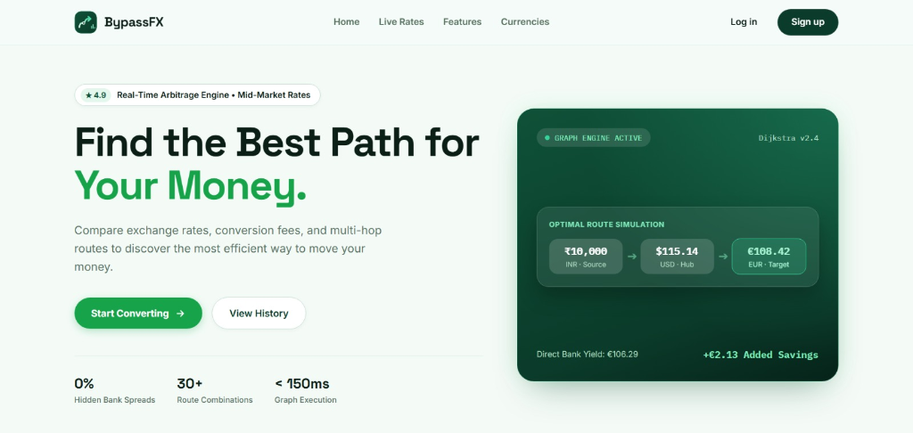
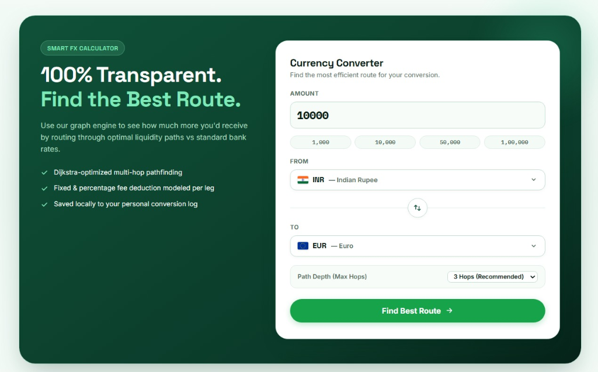
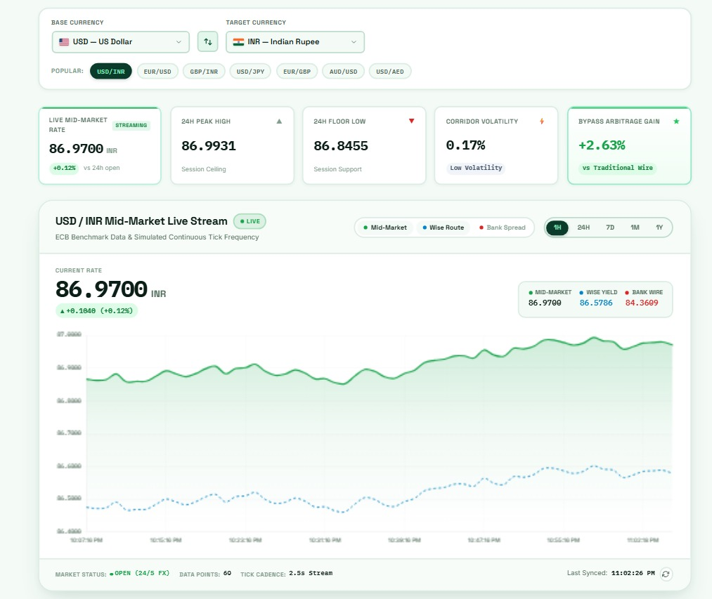
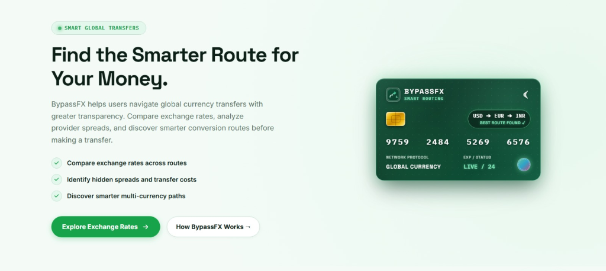

<div align="center">


# Bypass-FX

### _Find the cheapest path to convert your money -- across providers, across currencies._

[](https://nodejs.org/)
[](https://expressjs.com/)
[](https://www.mongodb.com/)
[](https://render.com/)
[](https://api.frankfurter.app)
[](LICENSE)

---

**Bypass-FX** is a fintech application designed to find the **cheapest conversion route** across multiple transfer providers (Wise, PayPal, Bank Wire) using live exchange rates and a multi-hop graph pathfinding algorithm.

Now in **Phase 2**, Bypass-FX features a full **Express.js + MongoDB** backend with **JWT authentication**, **bcrypt password hashing**, and automated hot-reloading with **Nodemon**, ready for one-click deployment on **Render**.

[Features](#features) | [Screenshots](#screenshots) | [Architecture](#architecture) | [Getting Started](#getting-started) | [API Endpoints](#api-endpoints) | [Deployment](#deployment-on-render)

</div>

---

## Table of Contents

- [Features](#features)
- [Screenshots](#screenshots)
- [Phase 2 Architecture](#architecture)
- [Project Structure](#project-structure)
- [Getting Started](#getting-started)
- [API Endpoints](#api-endpoints)
- [Deployment on Render](#deployment-on-render)
- [Tech Stack](#tech-stack)
- [License](#license)

---

## Features

| Feature | Description |
|---------|-------------|
| **Express.js REST API** | Production-ready backend built with Express 4, helmet security, and CORS protection |
| **MongoDB Database** | Persistent user profiles and conversion history powered by Mongoose ORM |
| **JWT Authentication** | Secure token-based session management with expiration and authorization middleware |
| **Bcrypt Security** | Industry-standard salted password hashing performed exclusively on the server |
| **Hot Reloading (Nodemon)** | Instant server restarts during development upon file modifications |
| **Live Exchange Rates** | Real-time mid-market rates from the [Frankfurter API](https://api.frankfurter.app) |
| **Smart FX Calculator** | Multi-hop corridor arbitrage across currency pairs and providers (1, 2, and 3 hops) |
| **Live Rate Ticker** | Animated marquee showing real-time currency pair movements |
| **Interactive Chart Studio** | Streaming charts with 1H, 24H, 7D, 1M, 1Y timeframes and multi-provider overlays |
| **Render-Ready** | Pre-configured `render.yaml` blueprint for zero-downtime deployment on Render |

---

## Screenshots

### Landing Page -- Hero Section
The hero section introduces BypassFX with an animated route simulation card showing a live INR to USD to EUR optimal path, along with key product metrics.



---

### Smart FX Calculator
The converter section features a two-panel layout: an informational panel explaining the graph pathfinding engine, and a fully interactive currency converter form with amount presets, currency selectors, and configurable hop depth.



---

### Live Market Rate Studio
The rates page delivers a full-featured chart studio with live streaming USD/INR mid-market data, 24H peak/floor metrics, corridor volatility stats, bypass arbitrage gain indicators, and multi-provider overlay comparison.



---

### Smart Global Transfers
A feature showcase section highlighting BypassFX's smart routing capabilities with a credit-card-style visual showing a live best-route discovery across USD, EUR, and INR.



---

## Architecture

```
+---------------------------------------------------------------------+
|                     LAYER 1 -- FRONTEND CLIENT                      |
|                                                                     |
|  index.html    login.html    signup.html    forgot-password.html    |
|  rates.html    profile.html                                         |
|                                                                     |
|  Client Modules: api.js (HTTP Client) | auth.js | home.js | charts.js|
+---------------------------------------------------------------------+
                               |
               HTTP REST Requests with Bearer JWT
                               v
+---------------------------------------------------------------------+
|              LAYER 2 -- EXPRESS.JS BACKEND (Node.js)                |
|                                                                     |
|  server.js          Express entry point, Helmet security, CORS      |
|  middleware/auth.js JWT Verification & Request Protection           |
|  middleware/rate.js Brute-force protection with express-rate-limit  |
|                                                                     |
|  Routes & Controllers:                                              |
|  - /api/auth        Signup, Login, Password Reset                   |
|  - /api/user        User Profile (/me), Account Settings, Deletion  |
|  - /api/history     Conversion History Save, Pagination, Clear      |
+---------------------------------------------------------------------+
               |                                        |
               v                                        v
+-------------------------------+  +-------------------------------+
|  LAYER 3a -- MONGODB DATABASE |  |   LAYER 3b -- EXTERNAL API    |
|                               |  |                               |
|  MongoDB Atlas / Mongoose     |  |  Frankfurter API              |
|  - Users Collection           |  |  api.frankfurter.app          |
|  - Conversions Collection     |  |  Live mid-market FX rates     |
+-------------------------------+  +-------------------------------+
```

---

## Project Structure

```
Bypass-FX/
|-- backend/                   # Phase 2 Express.js Backend
|   |-- config/
|   |   |-- db.js              # Mongoose connection & reconnection handler
|   |-- controllers/
|   |   |-- auth.controller.js # Signup, login, password reset logic
|   |   |-- user.controller.js # Profile retrieval & updates
|   |   |-- history.controller.js # Conversion history logging
|   |-- middleware/
|   |   |-- auth.js            # JWT Bearer token verification
|   |   |-- rateLimiter.js     # Rate limiting against brute-force attacks
|   |-- models/
|   |   |-- User.model.js      # User schema with bcrypt pre-save hook
|   |   |-- Conversion.model.js# Multi-hop conversion schema
|   |-- routes/
|   |   |-- auth.routes.js     # /api/auth routes
|   |   |-- user.routes.js     # /api/user routes
|   |   |-- history.routes.js  # /api/history routes
|   |-- .env.example           # Environment template
|   |-- package.json           # Backend dependencies & nodemon script
|   |-- server.js              # Express app entry point
|
|-- js/
|   |-- api.js                 # Centralised frontend API client (BypassAPI)
|   |-- auth.js                # Auth forms handler wired to BypassAPI
|   |-- home.js                # Converter, pathfinding, and live history
|   |-- charts.js              # Chart.js rates streaming
|   |-- ticker.js              # Ticker animation
|
|-- css/                       # Design system stylesheets
|-- assets/                    # Media assets and logos
|-- render.yaml                # Render Blueprint deployment specification
|-- index.html                 # Main landing page
|-- login.html                 # Sign in
|-- signup.html                # Registration
|-- profile.html               # User profile dashboard
|-- rates.html                 # Live FX charts
|-- package.json               # Root scripts (starts backend via nodemon)
|-- README.md
```

---

## Getting Started

### Prerequisites
- [Node.js](https://nodejs.org/) (v18 or higher)
- [MongoDB](https://www.mongodb.com/) (Local installation or free [MongoDB Atlas](https://www.mongodb.com/atlas) cluster)

### 1. Clone the repository
```bash
git clone https://github.com/Sakshamsoodcoder/BypassFX.git
cd Bypass-FX
```

### 2. Configure Environment Variables
Copy the `.env.example` file in `backend/` to `.env`:
```bash
cp backend/.env.example backend/.env
```
Edit `backend/.env` with your values:
```env
PORT=5000
NODE_ENV=development
MONGO_URI=mongodb+srv://<username>:<password>@cluster0.mongodb.net/bypassfx?retryWrites=true&w=majority
JWT_SECRET=your_super_secret_key_change_in_production
JWT_EXPIRES_IN=7d
CORS_ORIGIN=http://localhost:3000,http://127.0.0.1:5500
```

### 3. Install Dependencies
```bash
npm run install:backend
```

### 4. Run the Backend with Nodemon
From the project root:
```bash
npm run dev
```
Nodemon will monitor `backend/` and automatically restart whenever code changes:
```
[nodemon] starting `node server.js`
🚀 BypassFX API running on port 5000 [development]
   Health check -> http://localhost:5000/api/health
✅ MongoDB connected: cluster0.mongodb.net
```

### 5. Launch the Frontend
Open `index.html` in your browser (e.g., using VS Code Live Server on port 5500 or any static file server).

---

## API Endpoints

### Health Check
- `GET /api/health` -- Returns API status, environment, and database connection state.

### Auth Endpoints (`/api/auth`)
| Method | Endpoint | Description | Auth Required |
|--------|----------|-------------|---------------|
| `POST` | `/api/auth/signup` | Register new user, hashes password, returns JWT | No |
| `POST` | `/api/auth/login` | Authenticate credentials, returns JWT | No |
| `POST` | `/api/auth/forgot-password` | Issue short-lived password reset token | No |
| `POST` | `/api/auth/reset-password` | Reset password using reset token | No |

### User Endpoints (`/api/user`)
| Method | Endpoint | Description | Auth Required |
|--------|----------|-------------|---------------|
| `GET` | `/api/user/me` | Fetch logged-in user profile and aggregate stats | Yes (Bearer JWT) |
| `PATCH` | `/api/user/me` | Update user display name or email | Yes (Bearer JWT) |
| `DELETE` | `/api/user/me` | Delete account and all associated conversion history | Yes (Bearer JWT) |

### Conversion History Endpoints (`/api/history`)
| Method | Endpoint | Description | Auth Required |
|--------|----------|-------------|---------------|
| `GET` | `/api/history` | Paginated conversion history for authenticated user | Yes (Bearer JWT) |
| `POST` | `/api/history` | Save newly calculated route and metrics | Yes (Bearer JWT) |
| `DELETE` | `/api/history/:id` | Delete a single history record (ownership verified) | Yes (Bearer JWT) |
| `DELETE` | `/api/history` | Clear all conversion logs for current user | Yes (Bearer JWT) |

---

## Deployment on Render

This project includes a turnkey `render.yaml` configuration file for deploying the backend to **Render**:

1. Push your repository to **GitHub**.
2. Log into [Render Dashboard](https://dashboard.render.com/).
3. Click **New +** -> **Blueprint**.
4. Select your **BypassFX** repository.
5. Render will automatically detect `render.yaml` and configure the Web Service:
   - **Root Directory:** `backend`
   - **Build Command:** `npm install`
   - **Start Command:** `npm start`
6. Add your environment variables in the Render dashboard:
   - `MONGO_URI`: Your MongoDB Atlas connection string
   - `JWT_SECRET`: A secure random secret string
   - `CORS_ORIGIN`: Your frontend URL (e.g. `https://your-site.vercel.app`)
7. Once deployed, update `BASE_URL` in `js/api.js` to point to your live Render backend URL (`https://your-service.onrender.com`).

---

## Tech Stack

| Layer | Technology |
|-------|-----------|
| **Backend Framework** | [Express.js](https://expressjs.com/) (v4) on [Node.js](https://nodejs.org/) |
| **Database** | [MongoDB](https://www.mongodb.com/) with [Mongoose](https://mongoosejs.com/) ORM |
| **Authentication** | [JSON Web Tokens (JWT)](https://jwt.io/) + [Bcrypt.js](https://github.com/dcodeIO/bcrypt.js) |
| **Security & Middleware** | [Helmet](https://helmetjs.github.io/), [CORS](https://github.com/expressjs/cors), [Express Rate Limit](https://github.com/express-rate-limit/express-rate-limit) |
| **Dev Tooling** | [Nodemon](https://nodemon.io/) for automated server restarts |
| **Frontend** | Vanilla HTML5, CSS3, JavaScript (ES6+) |
| **Live FX Data** | [Frankfurter API](https://api.frankfurter.app) (European Central Bank benchmarks) |
| **Deployment** | [Render](https://render.com/) (Backend Web Service) + [Vercel](https://vercel.com/) (Static Frontend) |

---

## License

This project is open source and available under the [MIT License](LICENSE).

---

<div align="center">

**Built by Saksham Sood, Kartik Verma, and Kartik Sharma**

_If you found this useful, consider giving it a star!_

</div>
